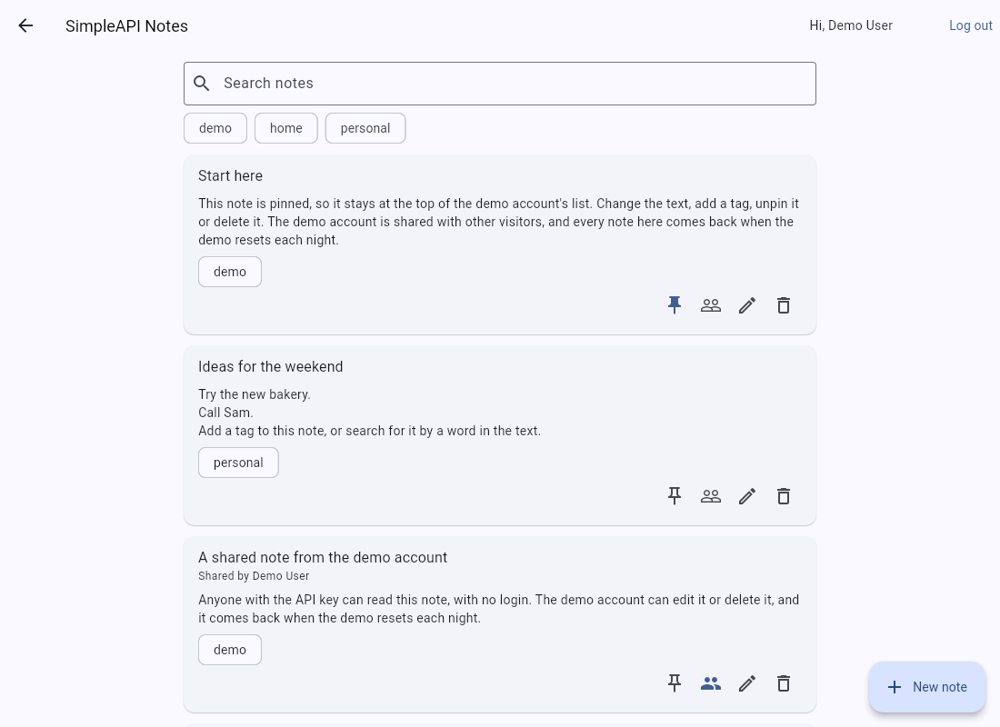

# SimpleAPI Notes API: Flutter web sample

A small Flutter web app that shows how to call the free [SimpleAPI Notes API](https://notes.simpleapi.dev/docs) from a browser, with no backend of your own.

**[Live demo](https://simple-api-dev.github.io/notes-client/)** | **[API docs](https://notes.simpleapi.dev/docs)** | **[Get a free key](https://keys.simpleapi.dev/?product=notes)**



## Run it

You need the [Flutter SDK](https://docs.flutter.dev/get-started/install) (stable; CI uses 3.47.8) and a free key from [keys.simpleapi.dev](https://keys.simpleapi.dev/?product=notes).

```bash
git clone https://github.com/simple-api-dev/notes-client
cd notes-client
flutter pub get
flutter run -d chrome --dart-define=SIMPLEAPI_KEY=YOUR_KEY
```

The live demo opens on the shared notes, which need only the key, with a **Try the demo account** button: one click logs in as a shared demo user, with no registration and no key handling. Run the tests with `flutter test`. All HTTP is mocked, so nothing calls the real API.

## How it calls the API

Your API key goes in the `apikey` query string. That is all the shared notes need. A logged-in user's own notes also need a bearer token.

```dart
// Shared notes: the key alone.
final shared = Uri.https('notes.simpleapi.dev', '/api/notes', {'apikey': apiKey});
final response = await http.get(shared, headers: {'Accept': 'application/json'});

// Your own notes: the key and a bearer token.
final mine = Uri.https('notes.simpleapi.dev', '/api/users/$userId/notes', {'apikey': apiKey, 'tag': 'work'});
final yours = await http.get(mine, headers: {
  'Accept': 'application/json',
  'Authorization': 'Bearer $token', // omitted for login and register
});
```

Every call lives in [`lib/notes_api.dart`](lib/notes_api.dart), one method per endpoint. The rest of the app never touches HTTP.

## Screens and API calls

| Screen | What it does | Calls |
| --- | --- | --- |
| **Notes** (`notes_screen.dart`), logged out | The shared notes with their authors. Search them, or filter by tag. It offers **Try the demo account** as the main action, and **Create an account** and **Log in**. The back arrow returns to simpleapi.dev. | `GET /api/notes` |
| **Notes** (`notes_screen.dart`), logged in | Your own notes, pinned first. Pin, share, delete, search and filter by tag. | `GET /api/users/{user_id}/notes`, `PUT /api/users/{user_id}/notes/{id}`, `DELETE /api/users/{user_id}/notes/{id}` |
| **New note, Edit note** (`note_dialog.dart`) | The form for a title, body, tags, pinned and shared. It stays open if the API refuses the note, and shows the API's message. | `POST /api/users/{user_id}/notes`, `PUT /api/users/{user_id}/notes/{id}` |
| **Log in / Register** (`auth_screen.dart`) | Get a token, or **Try the demo account**. **Log out** is in the app bar. | `POST /api/users/register`, `POST /api/users/login`, `POST /api/users/logout` |
| **Reset password** (`forgot_screen.dart`) | Email a 6-digit code, then send it with a new password. | `POST /api/users/forgot`, `POST /api/users/reset` |

`{user_id}` is always the logged-in user's own id, taken from the `user` object in the register or login answer. The API has more endpoints than this sample uses, such as reading one note, changing or deleting your account and admin calls. See the [full docs](https://notes.simpleapi.dev/docs).

## Use your own key

The live demo is built with a shared demo key. The app has no screen for entering a key: it uses only the key compiled in at build time. To run it with your own, pass it to Flutter:

```bash
flutter run -d chrome --dart-define=SIMPLEAPI_KEY=YOUR_KEY
```

Get a free key at [keys.simpleapi.dev](https://keys.simpleapi.dev/?product=notes).

## Good to know

- Every error is JSON, `{"message": "..."}`. The app shows readable text for 400, 401, 403, 404, 409, 422, 429 and 503.
- Login and register answer `{"token": "...", "expires_at": "...", "user": {...}}`. A token lasts 30 days, and logging out ends only this session.
- A list answers `{"data": [...], "total": 42, "page": 1, "per_page": 25}`. This app asks for `per_page=100`, the most a page can hold, and shows **Load more** if there is another page.
- `GET /api/notes` shows only shared notes, newest first, and never sends the bearer token. A logged-in user's own list has pinned notes first, then newest first.
- Both lists take `?q=` (the title or body contains it) and `?tag=`. Your own list also takes `?pinned=true`, which this sample does not use. There is no list of tags, so the filter chips are the tags seen in the list. The search waits for a pause in typing, to stay within the rate limit.
- A `PUT` changes only the fields you send, so the pin button sends `pinned`, the share button sends `shared` and the form sends what changed. Sending `"tags": []` clears the tags.
- `author` is the name of the user who wrote the note, or `null` if there is none. The app then says "by Unknown".
- The app loads the list again after each change, so a pinned note moves to the top and the filters stay right.
- A bad or missing key answers `401`. So does a dead token; the app then logs you out and shows the shared notes. A failed login is also a `401` ("Invalid email or password.") and is shown on the form.
- Login and register never send the bearer token.
- A new user or note answers `201`. Registering an email that is already taken answers `409`.
- A key holds 25 users, and each user may have 100 notes. The call that would go over answers `403`.
- A title holds up to 200 characters and a body up to 10000. A note holds up to 10 tags of 30 characters each, and the API stores them in lowercase. The app leaves these checks to the API and shows its message.
- Passwords need at least 8 characters.
- The API allows 60 requests a minute per IP address. More answers `429`.
- The demo account is `demo@simpleapi.dev` with password `try-the-demo`. It is public by design and shared by every visitor, and the live demo resets every night, so do not use a real password or any private details. When the demo key has no room for more users, registering shows "The demo is full. It resets every night." The API refuses `users/forgot` and `users/reset` for it with `403` `The demo account cannot be changed.`, and the app shows that message.

## Project layout

```
lib/notes_api.dart        the whole API client
lib/models.dart           Note, NotePage, AuthResult and ApiException
lib/app_state.dart        the logged-in user and demo login (a ChangeNotifier)
lib/open_url*.dart        opens the SimpleAPI home page (the back arrow)
lib/config.dart           the build-time key (SIMPLEAPI_KEY) and the demo account
lib/screens/              the screens, and ui.dart with shared widgets and error wording
test/                     unit tests for the client, widget tests for the app
```

## Deploy to GitHub Pages

[`.github/workflows/pages.yml`](.github/workflows/pages.yml) runs on every push to `main`. It runs `flutter analyze` and `flutter test`, builds with `flutter build web --release --base-href /notes-client/`, and publishes with the official Pages actions.

In your own copy:

1. Set **Settings, Pages, Source** to **GitHub Actions**.
2. Add a repository **variable** named `SIMPLEAPI_KEY` under **Settings, Secrets and variables, Actions, Variables**. The build passes it with `--dart-define=SIMPLEAPI_KEY=...`.
3. Push to `main`, or run the workflow.

Anything passed with `--dart-define` ends up in the compiled JavaScript, so anyone can read it from the deployed site. Use a free key made for a public demo. If you rename the repository, change `--base-href` to match.

## License

[MIT](LICENSE)
